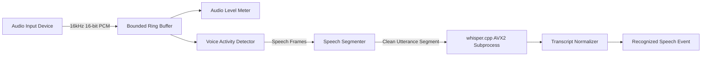

# Pulpit AI — Audio & Speech Recognition Pipeline

## 1. Overview
The Pulpit AI Audio & Speech Pipeline is designed for low-latency, privacy-preserving, local-first operation on constrained hardware (Intel Core i5-6300U, 2 cores / 4 threads, 8 GB RAM, 11 GB SSD).

## 2. Audio Acquisition & Ring Buffer
* **Standard Format:** 16-bit signed PCM mono at 16,000 Hz.
* **Bounded Volatile Buffer:** 10 seconds capacity (~320 KB RAM). If reading is delayed, the oldest unread frames are dropped to prevent memory growth.
* **Zero Disk Storage:** No raw audio is ever persisted to SSD or sent to external cloud networks.

## 3. Voice Activity Detection (VAD)
* Evaluates 30ms frames (480 samples).
* Calculates short-time energy (RMS) and Zero-Crossing Rate (ZCR).
* Rejects low-frequency DC rumble and high-frequency noise.
* Ensures inference only runs during active speech, keeping CPU utilization minimal.

## 4. Speech Segmentation & Utterance Slicing
* Gathers continuous speech frames.
* Minimum phrase length: 1.0 second.
* Maximum phrase length: 5.0 seconds.
* Silence hangover: ~450ms of silence cuts an utterance cleanly without chopping words mid-phoneme.
* **Device Switch Flush:** Switching inputs immediately purges partial buffers and retags context to prevent cross-device word merging.

## 5. Local Speech Recognition Worker (`whisper.cpp`)
* Standalone C++ executable compiled with AVX2 optimizations for Intel Skylake CPUs.
* Default model: `base.en-q5_1` (57 MB, ~250 MB RAM).
* Disk-safety guardrails: Requires >= 2 GB free space before downloading any model.
* Crash containment: If the worker process exits unexpectedly, the host catches the signal, triggers clean restart, and maintains a strict fail-closed authority state (`projectionPermission = false`).

## 6. Transcript Normalization & Scripture Routing
* **Raw Text Preservation for Parsing:** The Scripture candidate generator and rolling 3-utterance context window receive `event.rawText` directly. Spoken compounds (e.g., *"twenty-three"*, *"one hundred and nineteen"*) are preserved and deterministically parsed as single numerical entities (e.g., 23, 119) rather than split one-by-one digits.
* **Display & Tokenization Normalizer:** `TranscriptNormalizer` is reserved for UI display and token chips only. It resolves compound spoken numbers (tens + ones, hundreds) into proper integer representations so the operator transcript displays clean numbers without corrupting the underlying canonical parsing pipeline.
