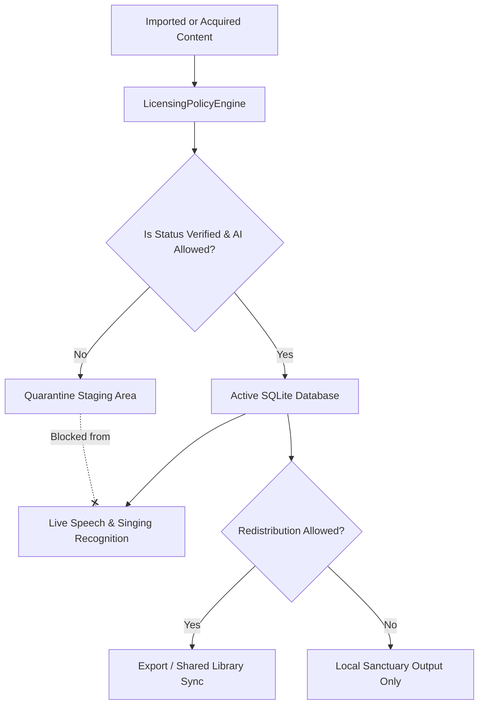

# Pulpit AI — Content Licensing Matrix

This matrix defines the legal rights and software boundaries for all content types processed by Pulpit AI, enforcing compliance with Section 7 and Section 13 of the build specification.

---

## 1. Scripture Translation Licensing Matrix

| Translation / Edition | Copyright Owner | License Type | Offline Storage | Local Sanctuary Projection | Open-Source Redistribution | Commercial Use | AI Recognition Indexing | Mandatory Attribution Requirement |
| :--- | :--- | :--- | :---: | :---: | :---: | :---: | :---: | :--- |
| **World English Bible (WEB)** | Michael Paul Johnson | Dedicated Public Domain | **YES** | **YES** | **YES** | **YES** | **YES** | `World English Bible (WEB) — Dedicated to the Public Domain` |
| **King James Version (KJV)** | Public Domain (1769 Oxford Blayney) | Public Domain | **YES** | **YES** | **YES** | **YES** | **YES** | `King James Version (KJV) — Public Domain` |
| **English Standard Version (ESV)** | Crossway (Good News Publishers) | Proprietary Commercial | **API Cache Only** (<500 verses) | **YES** (Church service quote) | **NO** | **NO** | **NO** (Without written publisher agreement) | `Scripture quotations are from the ESV® Bible (The Holy Bible, English Standard Version®), copyright © 2001 by Crossway...` |
| **New Living Translation (NLT)** | Tyndale House Ministries | Proprietary Commercial | **API Cache Only** (<500 verses) | **YES** (Church service quote) | **NO** | **NO** | **NO** (Without publisher contract) | `Scripture quotations marked (NLT) are taken from the Holy Bible, New Living Translation, copyright © 1996, 2004, 2015 by Tyndale House Foundation...` |
| **Amplified Bible (AMP)** | The Lockman Foundation | Proprietary Commercial | **NO** | **YES** (Fair Use quote) | **NO** | **NO** | **NO** | `Scripture quotations taken from the Amplified® Bible (AMP), Copyright © 2015 by The Lockman Foundation...` |
| **The Message (MSG)** | NavPress Publishing | Proprietary Commercial | **NO** | **YES** (Fair Use quote) | **NO** | **NO** | **NO** | `Scripture taken from THE MESSAGE, copyright © 1993, 2002 by Eugene H. Peterson. Used by permission of NavPress.` |

---

## 2. Hymn and Song Licensing Matrix

| Catalogue / Work Category | Typical Copyright Holder | License Type | Offline Storage | Local Sanctuary Projection | Open-Source Redistribution | Commercial Use | AI Lyric Matcher Indexing | Handling in Pulpit AI Engine |
| :--- | :--- | :--- | :---: | :---: | :---: | :---: | :---: | :--- |
| **Historical Public Domain Hymns** (Pre-1928, e.g. *Amazing Grace*, *Blessed Assurance*) | Public Domain | Public Domain | **YES** | **YES** | **YES** | **YES** | **YES** | Pre-bundled in default library; verified status; active in lyric recognition engine. |
| **Open Hymnal Releases** | Curated by Brian J. Dumont | CC-BY-SA 3.0 / Dedicated PD | **YES** | **YES** | **YES** | **YES** (with SA) | **YES** | Bundled with explicit attribution to Open Hymnal and original author. |
| **Worship Commons Catalogues** | Individual worship leaders | Creative Commons (CC-BY, CC-BY-NC) | **YES** | **YES** | **YES** (Under CC terms) | **RESTRICTED** (Check NC clauses) | **YES** | Tagged with CC licence URI and author credits. |
| **Church-Owned Original Songs** | Local Church Congregation / Worship Team | Church Internal (`church_owned`) | **YES** | **YES** | **NO** (Internal church private library) | **NO** | **YES** (Upon operator approval in review workflow) | Quarantined on import until operator confirms rights; never synced to external shared packages. |
| **CCLI-Covered Commercial Worship** (e.g. Bethel, Elevation, Hillsong, Tomlin) | Commercial Music Publishers (Capitol CMG, Essential Music, etc.) | CCLI Church License (`ccli_covered`) | **YES** (Local SQLite instance only) | **YES** (Inside licensed church venue) | **STRICTLY PROHIBITED** | **NO** | **YES** (Local operator verified only) | CCLI number stored; `redistributionPermission = false`; blocked from public export or shared sync. |
| **Unverified Multi-Format Imports** (TXT, CSV, DOCX, PPTX, PDF) | Unknown / Unverified | Pending Review (`custom_restricted`) | **YES** (Staging Quarantine) | **PROHIBITED** | **PROHIBITED** | **PROHIBITED** | **PROHIBITED** (Fail-closed) | Kept in `StagedSongImport` quarantine until reviewed and explicitly approved by operator. |

---

## 3. Enforcement in Core Modules

The software strictly enforces these boundaries across distinct modules:

1. **`@pulpit-ai/licensing-manager`**:
   - `LicensingPolicyEngine.evaluateRecognitionAccess(metadata)`: Fails closed unless `verificationStatus === 'verified'` and `aiProcessingPermission === true`.
   - `LicensingPolicyEngine.evaluateRedistribution(metadata)`: Fails closed unless `redistributionPermission === true` and `verificationStatus === 'verified'`.
2. **`@pulpit-ai/scripture-engine`**:
   - `ScriptureDatabase.getPassage()`: Validates translation verification and returns mandatory legal attribution with every retrieved text passage.
3. **`@pulpit-ai/song-engine`**:
   - `SongDatabase.searchSongs(query, approvedOnly = true)`: Excludes quarantined drafts and unverified items from acoustic lyric matching.
   - `CuratedPackageSync`: Strictly verifies that only songs with explicit redistribution rights can be included in shared library packages.
